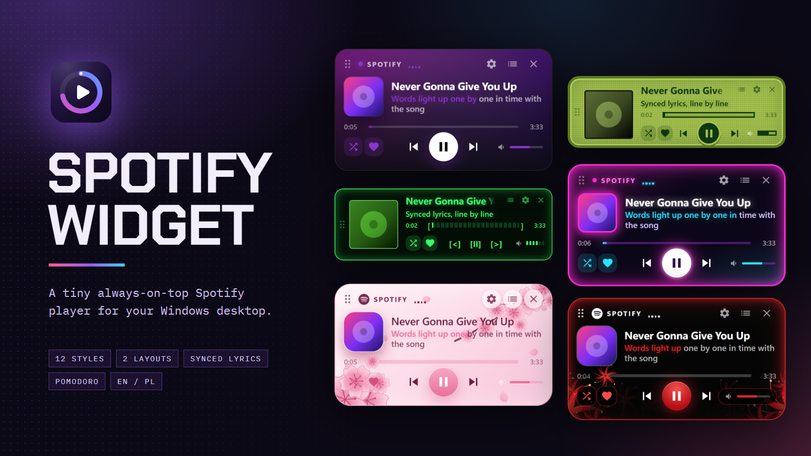
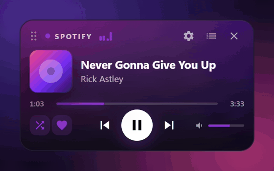
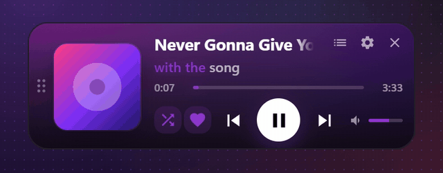
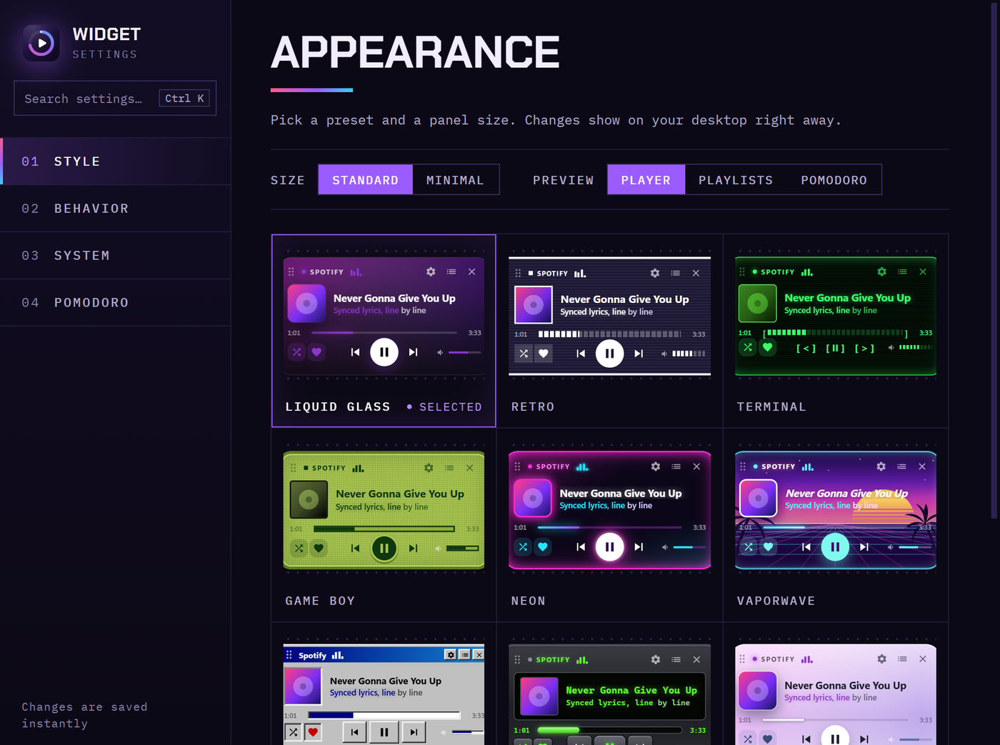
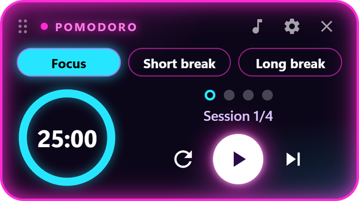
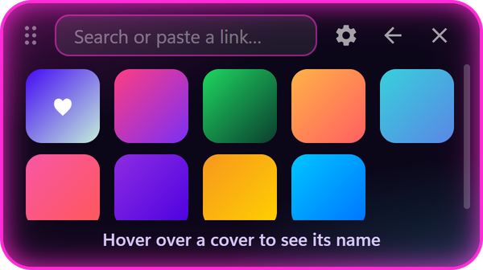
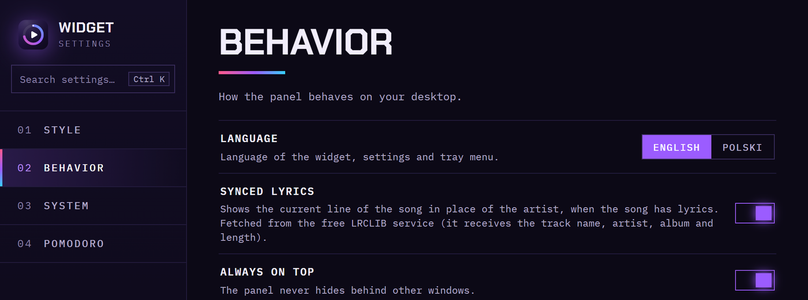
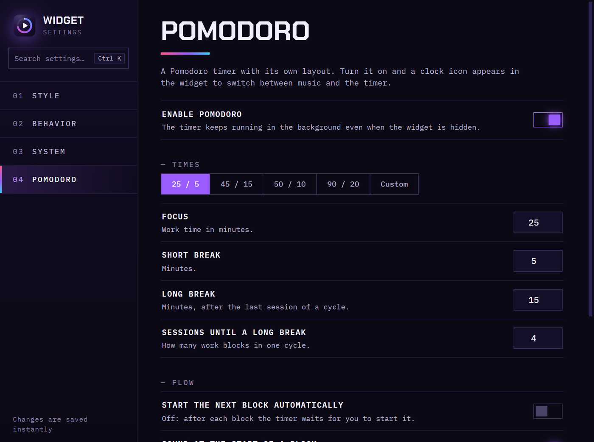

<div align="center">

# Spotify Widget

**A tiny, always-on-top Spotify player for your Windows desktop.**

English · [Polski ↓](#polski)



</div>

---

# English

A minimal Spotify overlay (Windows, Electron): cover art, title, artist, a seekable progress bar,
play/pause/skip, shuffle, volume, a one-click playlist browser, a like button, a built-in Pomodoro timer
and **12 visual presets in 2 layouts**. It lives in the system tray, starts with Windows and updates itself.



## Features

- **Player**: cover, title, artist, progress bar (click or drag to seek), play/pause/next/previous, shuffle, volume.
- **Playlists**: covers only, the name shows on hover. Paste a link/URI of a playlist, album, artist or podcast and press Enter.
  Hover a cover and click ≡ (or right-click) to pick a single track.
- **Like button (♥)**: adds/removes the current track from your Liked Songs.
- **12 styles × 2 layouts** (standard and minimal): Liquid Glass, Retro, Terminal, Game Boy, Neon, Vaporwave, Win98, Winamp, Glass, Y2K, Sakura, Higanbana.
- **Pomodoro timer** that runs in the background, with presets (25/5, 45/15, 50/10, 90/20), sounds and optional focus music.
- **Synced lyrics** (optional, off by default): the current line of the song shows under the title, animates in and lights up word by word in time with the music. Lines that do not fit are split into short parts that follow the song, so nothing is ever cut off. Lyrics come from the free [LRCLIB](https://lrclib.net) service, which receives only the track name, artist, album and length. Turn it on in *Settings → Behavior*.
- **English and Polish** interface (switch it in *Settings → Behavior*).
- **Tray icon**, always on top, launch with Windows, automatic updates from GitHub Releases.



<sub>The GIF uses demo text, not real lyrics. With the option on, real songs show their own synced lyrics in exactly the same way.</sub>



<table>
<tr>
<td></td>
<td></td>
</tr>
<tr>
<td align="center">Pomodoro timer</td>
<td align="center">Playlist browser</td>
</tr>
</table>

<table>
<tr>
<td></td>
<td></td>
</tr>
<tr>
<td align="center">Behavior: language, synced lyrics, always on top</td>
<td align="center">Pomodoro: times, sounds and focus music</td>
</tr>
</table>

## Install

1. Open the **Releases** tab of this repo and download `Spotify-Widget-Setup-x.y.z.exe`.
2. Run it. It installs without questions and starts right away (Windows SmartScreen may warn you because the file is
   not code-signed: **More info → Run anyway**).
3. On the first launch, sign in with Spotify (see below).

Uninstall: **Settings → Apps → Spotify Widget**.

## Updates

The installed app checks **Releases** on start and every 6 hours. When there is a newer version it downloads it in the
background and installs it when you quit (or right away from the tray menu: **Install update and restart**). By default it also
installs and restarts automatically at startup (toggle: **Update automatically on start**). Manual check: right-click the tray icon →
**Check for updates**. Auto-updates need a public repo.

## First sign-in (once)

Spotify requires your own app to control playback:

1. Go to <https://developer.spotify.com/dashboard> → **Create app**.
2. Add exactly this **Redirect URI**: `http://127.0.0.1:8888/callback`
   (the widget shows it and copies it on click). Tick **Web API**.
3. Copy the **Client ID** from the app settings, paste it into the widget and click **Sign in**.

> Controlling playback usually requires a Spotify **Premium** account, and Spotify has to be running (on this computer or another device).

## Sharing with a friend

The installer is self-contained, so just send the link to **Releases** or the `.exe` itself (about 115 MB). It contains no accounts or keys,
everybody signs in on their own. Your friend has two options:

1. **Their own Spotify app** (easiest, about 5 minutes): the steps from “First sign-in”.
2. **Someone else's Client ID** (e.g. yours): the app owner has to add the friend's email under **User Management** in the
   dashboard (development mode only works for people on that list, up to 25). Without it, sign-in fails.

## Troubleshooting

| Problem | Fix |
| --- | --- |
| Windows warns on launch | The file is not signed. **More info → Run anyway**. |
| Sign-in: error / “INVALID_CLIENT” | Check the Client ID and that the Redirect URI is exactly `http://127.0.0.1:8888/callback`. |
| Sign-in: 403 / “user not registered” | Add the user's email under **User Management** in the Spotify app. |
| “Port 8888 in use” | Close the program using port 8888 and try again. |
| Pause/skip do nothing | Spotify usually needs **Premium** for remote control and must be running. |
| A playlist is missing (e.g. DJ, Daily Mix) | Paste its link into the search box and press Enter. |

## Usage

- **☰**: playlists instead of the player (same window). Search, click, or paste a link and press Enter. **Esc** or the arrow goes back.
  **DJ (Spotify AI)** is at the top of the list.
- **Heart (♥)** next to shuffle: adds the current track to Liked Songs (or removes it). The first time, Spotify asks for one extra
  permission (library access); just approve it in the browser.
- **Pick a track from a playlist**: hover a cover and click ≡ (or right-click). Works for your own and shared playlists and Liked Songs
  (Spotify does not expose the tracks of other people's playlists, DJ and mixes).
- **Dragging**: grab the grip dots or the cover. The position is remembered.
- **Pomodoro**: enable it in *Settings → Pomodoro*; a clock icon then switches between music and the timer.
- **Tray icon**: show/hide, always on top, launch with Windows, sign out, quit.

## Development

```bash
npm install
npm start          # run in dev mode
npm run dist       # build the installer into dist/
```

## License

MIT, see [LICENSE](LICENSE).

---

<a id="polski"></a>

# Polski

Minimalistyczna nakładka Spotify na pulpit (Windows, Electron): okładka, tytuł, wykonawca, pasek postępu z przewijaniem,
play/pauza/skip, losowo, głośność, szybki wybór playlist, serduszko, wbudowany timer Pomodoro i **12 presetów wyglądu w 2 układach**.
Siedzi w zasobniku, startuje z Windowsem i sama się aktualizuje.

[English ↑](#english)

## Funkcje

- **Odtwarzacz**: okładka, tytuł, wykonawca, pasek postępu (klik lub przeciąganie), play/pauza/następny/poprzedni, losowo, głośność.
- **Playlisty**: same okładki, nazwa po najechaniu. Wklej link/URI playlisty, albumu, wykonawcy lub podcastu i naciśnij Enter.
  Najedź na okładkę i kliknij ≡ (albo prawy klik), żeby wybrać pojedynczy utwór.
- **Serduszko (♥)**: dodaje/usuwa bieżący utwór z polubionych.
- **12 stylów × 2 układy** (standardowy i minimalistyczny): Liquid Glass, Retro, Terminal, Game Boy, Neon, Vaporwave, Win98, Winamp, Glass, Y2K, Sakura, Higanbana.
- **Timer Pomodoro** działający w tle, z presetami (25/5, 45/15, 50/10, 90/20), dźwiękami i opcjonalną muzyką do pracy.
- **Napisy do utworów** (opcjonalne, domyślnie wyłączone): aktualna linijka piosenki pokazuje się pod tytułem, delikatnie wjeżdża i zapala się słowo po słowie w rytm muzyki. Linijki, które się nie mieszczą, dzielą się na krótkie części zmieniane w rytm utworu, więc nic nie jest ucinane. Teksty pochodzą z darmowej usługi [LRCLIB](https://lrclib.net), która dostaje tylko tytuł, wykonawcę, album i długość utworu. Włączysz je w *Ustawienia → Zachowanie*.
- **Interfejs po angielsku i polsku** (przełączasz w *Ustawienia → Zachowanie*).
- **Ikona w zasobniku**, zawsze na wierzchu, start z Windowsem, autoaktualizacje z GitHub Releases.

## Instalacja (dla użytkownika)

1. Wejdź w zakładkę **Releases** tego repo i pobierz `Spotify-Widget-Setup-x.y.z.exe`.
2. Uruchom plik. Instaluje się bez pytań i od razu startuje (Windows SmartScreen może
   ostrzec, bo plik nie jest podpisany: **Więcej informacji → Uruchom mimo to**).
3. Przy pierwszym uruchomieniu zaloguj się przez Spotify (patrz niżej).

Odinstalowanie: **Ustawienia → Aplikacje → Spotify Widget**.

## Aktualizacje

Zainstalowana wersja sama sprawdza **Releases** przy starcie i co 6 godzin. Gdy jest nowsza,
pobiera ją w tle i instaluje po zamknięciu aplikacji (albo od razu z menu w zasobniku:
**Zainstaluj aktualizację i zrestartuj**). Domyślnie przy starcie instaluje i restartuje się sama
(przełącznik: **Aktualizuj automatycznie przy starcie**). Ręcznie: prawy klik na ikonie → **Sprawdź aktualizacje**.
Autoaktualizacje wymagają publicznego repo.

## Pierwsze logowanie (raz)

Spotify wymaga własnej aplikacji, żeby sterować odtwarzaniem:

1. Wejdź na <https://developer.spotify.com/dashboard> → **Create app**.
2. W **Redirect URI** dodaj dokładnie: `http://127.0.0.1:8888/callback`
   (nakładka pokazuje ten adres, klik go kopiuje). Zaznacz **Web API**.
3. Skopiuj **Client ID** z ustawień aplikacji, wklej w nakładce i kliknij **Zaloguj**.

> Do sterowania odtwarzaniem Spotify zwykle wymaga konta **Premium**.
> Spotify musi być uruchomione na komputerze (albo na innym urządzeniu).

## Udostępnianie znajomemu

Instalator jest samodzielny (zawiera wszystko), więc wystarczy wysłać link do **Releases**
albo sam plik `.exe` (ok. 115 MB). W instalatorze nie ma żadnych kont ani kluczy, każdy loguje się
sam. Znajomy ma dwie opcje:

1. **Własna aplikacja Spotify** (najprościej, ok. 5 minut): kroki z sekcji „Pierwsze logowanie”.
2. **Cudzy Client ID** (np. Twój): właściciel aplikacji musi w dashboardzie, w zakładce
   **User Management**, dodać e-mail znajomego (tryb deweloperski działa tylko dla osób z listy,
   do 25). Bez tego logowanie zwróci błąd.

## Rozwiązywanie problemów

| Problem | Rozwiązanie |
| --- | --- |
| Windows ostrzega przy uruchomieniu | Plik jest niepodpisany. **Więcej informacji → Uruchom mimo to**. |
| Logowanie: błąd / „INVALID_CLIENT” | Sprawdź Client ID i czy Redirect URI to dokładnie `http://127.0.0.1:8888/callback`. |
| Logowanie: 403 / „user not registered” | Dodaj e-mail użytkownika w **User Management** aplikacji Spotify. |
| „Port 8888 zajęty” | Zamknij program używający portu 8888 i spróbuj ponownie. |
| Pauza/skip nie reagują | Spotify zwykle wymaga **Premium** do sterowania z zewnątrz i musi być uruchomione. |
| Brak playlisty (np. DJ, Daily Mix) | Wklej link do niej w polu wyszukiwania i naciśnij Enter. |

## Obsługa

- **☰**: playlisty zamiast playera (to samo okno). Szukaj, klikaj, albo wklej link
  do playlisty/albumu/wykonawcy i naciśnij Enter. **Esc** lub strzałka wraca do playera.
  Na górze listy jest **DJ (Spotify AI)**.
- **Serduszko (♥)** obok przycisku losowo: dodaje bieżący utwór do polubionych (i usuwa z nich). Przy pierwszym użyciu
  Spotify poprosi o dodatkową zgodę (dostęp do biblioteki); wystarczy ją zatwierdzić w przeglądarce.
- **Wybór utworu z playlisty**: najedź na okładkę i kliknij ikonę ≡ (albo prawy klik), żeby zobaczyć utwory i zagrać wybrany.
  Działa dla Twoich i współdzielonych playlist oraz Polubionych (Spotify nie udostępnia utworów playlist cudzych, DJ-a i miksów).
- **Przeciąganie**: złap za kropki uchwytu albo okładkę. Pozycja jest zapamiętywana.
- **Pomodoro**: włącz w *Ustawienia → Pomodoro*; ikona zegara przełącza wtedy muzykę i timer.
- **Ikona w zasobniku**: pokaż/ukryj, zawsze na wierzchu, start z Windowsem, wylogowanie, zamknij.

## Dla developerów

```bash
npm install
npm start          # uruchom w trybie dev
npm run dist       # zbuduj instalator do folderu dist/
```

## Licencja

MIT, patrz [LICENSE](LICENSE).
